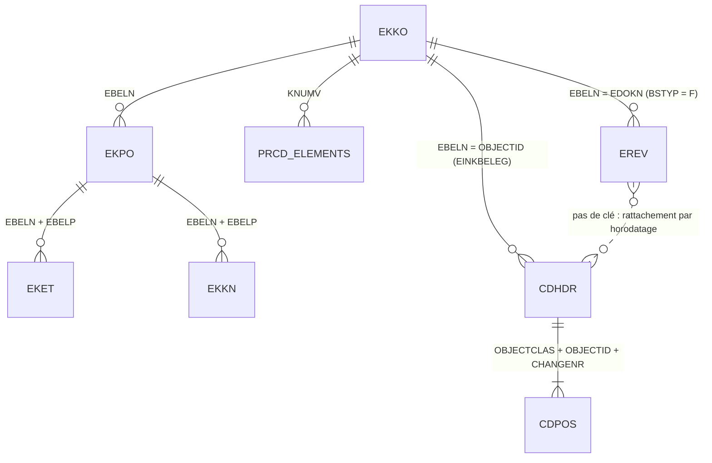

> [!abstract] En bref
> SAP ne stocke pas de copie de la commande à chaque version : l'état courant est dans EKKO/EKPO/…, les versions dans EREV, les changements dans CDHDR/CDPOS.
> La fiche décrit le fonctionnement, le modèle de données et une méthode pour restituer l'état complet à chaque version (copies en tables Z + vues CDS).

## Fonctionnement, tables, et restitution de l'état complet de la commande à chaque version

| Élément | Valeur |
|---|---|
| Périmètre | Commandes d'achat (catégorie de document `F`) |
| Release visée | SAP S/4HANA 2023 on-premise / Private Cloud (gestion des versions « classique », composant MM-PUR-GF-VER) |
| Contexte client | Table `EREV` alimentée. Commandes modifiées via **ME22N** |
| Besoin | **État complet de la commande à chaque version** (en-tête, postes, échéances, imputations, conditions), restitué par **vues CDS** |
| Public | Fonctionnel (sections 1 à 3) et technique / data (sections 4 à 8) |
| Version du document | v2 – 25/11/2026 (v1 : fonctionnement et liste des modifications par version) |

**Légende des marqueurs** (utilisés seulement quand une information n'est pas évidente) :
- **[Vérifié]** : confirmé par une source consultée (voir section 10).
- **[Connaissance]** : connaissance SAP générale, non revérifiée pour ce document.
- **[Déduction]** : raisonnement à partir d'éléments vérifiés. La base est indiquée.
- **[Hypothèse]** : supposition à valider sur le système.

---

## 1. Synthèse

1. Une **version** regroupe les documents de modification produits entre deux états validés de la commande. La version 0 est la commande d'origine, et chaque révision porte le numéro suivant. **[Vérifié]**
2. **SAP ne stocke pas de copie complète de la commande pour chaque version.** On trouve :
   - l'état courant dans `EKKO` / `EKPO` / `EKET` / `EKKN` / `PRCD_ELEMENTS` ;
   - les métadonnées de chaque version dans **`EREV`** ;
   - le détail des changements dans **`CDHDR` / `CDPOS`** (objet `EINKBELEG`). **[Vérifié]**
3. Il n'existe pas de clé directe entre `EREV` et `CDHDR`/`CDPOS`. Pour rattacher un changement à une version, on compare des **horodatages** (section 5). **[Déduction]**
4. **Pour obtenir l'état complet à chaque version, je recommande de stocker une copie de la commande par version** dans des tables Z, puis d'exposer ces tables par des vues CDS simples (section 7). Les tables Z sont alimentées de deux façons :
   - **historique** (versions déjà existantes) : un programme de **reconstitution à rebours** à partir de l'état courant et des documents de modification. Le résultat est **fiable à 100 % seulement pour les champs journalisés** (section 6) ;
   - **à partir de la mise en production** : une **copie exacte** prise à chaque enregistrement en ME22N et écrasée tant que la version reste la même. La dernière copie d'une version donne son état final.
5. Calculer cet état à la volée, uniquement en CDS, est déconseillé. Il faudrait reconvertir des valeurs stockées en texte dans `CDPOS` et gérer les postes créés et supprimés : les vues seraient complexes et coûteuses pour un résultat moins fiable (section 6.4).
6. **Contrôle de cohérence disponible** : `EREV-NETWR` donne la valeur nette de chaque version. La somme des valeurs nettes des postes reconstitués doit la retrouver (section 6.5). **[Déduction]**
7. **Aucune vue CDS standard SAP sur `EREV` pour les commandes n'a été trouvée** **[Hypothèse – à confirmer par un Where-Used dans ADT]**.

---

## 2. Fonctionnement fonctionnel

### 2.1 Ce qu'est une version, et ce qu'elle n'est pas

| Notion | Rôle | À ne pas confondre avec |
|---|---|---|
| **Version** (`EKKO-REVNO`, `EREV-REVNO`) | Niveau de révision de la commande vis-à-vis du fournisseur : version 0 = original, 1, 2… = révisions | — |
| **Documents de modification** (`CDHDR`/`CDPOS`) | Journal de **chaque** modification de champ | Une version **regroupe** des documents de modification. Elle ne les remplace pas. **[Vérifié]** |
| **Niveau de révision** (`EKPO-REVLV`) | Indice de révision **de l'article** (gestion des modifications techniques) | Sans rapport avec les versions de commande **[Connaissance]** |
| **Historique de commande** (`EKBE`) | Entrées de marchandises, factures… | Sans rapport avec les versions |

### 2.2 Cycle de vie d'une version

1. **Création de la commande** : le système crée automatiquement la **version 0** (niveau en-tête). Toute modification ultérieure est rattachée à la version courante. **[Vérifié]**
2. **Clôture** : l'acheteur coche **« Terminé »** (`EREV-REVOK`). Le paramétrage peut clôturer automatiquement la version 0 (« Version 0 OK »). **[Vérifié]**
3. **Après clôture** : les modifications restent rattachées à la version courante tant que le système n'a pas créé de nouvelle version. **[Vérifié]**
4. **Nouvelle version** : elle n'est créée que si **toutes** les conditions suivantes sont réunies. **[Vérifié]**
   - la commande a atteint un état final : « Actif » sans stratégie de libération, « Libération terminée » avec stratégie ;
   - tous les messages de la commande ont été transmis ;
   - la modification est pertinente pour l'impression (voir 2.4) ;
   - la commande n'est pas en attente (`EKKO-MEMORY = 'X'`).
5. **Libération et sortie** : une commande ne peut être libérée ni émise que si sa version est **terminée**. **[Vérifié]**

Pour les commandes d'achat, il y a une version par **document**. Pour les demandes d'achat, c'est une version par poste. **[Vérifié]**

### 2.3 Statut de traitement et stratégie de libération

| Champ | Contenu | Valeurs |
|---|---|---|
| `EKKO-PROCSTAT` | Statut de traitement **actuel** | 01 Version en cours, 02 Actif, 03 En libération, 04 Partiellement libéré, 05 Libération terminée, 08 Refusé **[Vérifié]** |
| `EREV-BANPR` | Statut de traitement **avant** la version | Mêmes valeurs **[Vérifié]** |

Les deux peuvent diverger (KBA 2796191). **[Vérifié]** Ne pas utiliser `EREV-BANPR` comme statut courant de la commande.

### 2.4 Ce qui déclenche une nouvelle version, et ce qui n'en déclenche pas

- **Déclenchent** une nouvelle version : les modifications de champs **pertinents pour l'impression des modifications** (table `T166C`). **[Vérifié]**
- **Cas particuliers** : **[Vérifié]**
  - changement d'adresse : seulement si `ADRC-NAME1` est pertinent pour l'impression ;
  - changement de conditions : seulement si `EKPO-NETPR` est pertinent pour l'impression (KBA 2712637) ;
  - modification d'un **texte** : pas de nouvelle version (KBA 1644559) ;
  - **ajout d'un poste** : peut créer une nouvelle version (KBA 3595940).
- Une **version n'est donc pas un compteur de modifications** : une version peut contenir de nombreux changements.

### 2.5 Transactions et applications

| Outil | Gestion des versions |
|---|---|
| ME21N / ME22N / ME23N | Onglet **Versions** en en-tête. Le bouton **Afficher modifications** liste les modifications par version **[Vérifié]** |
| Fiori *Manage Purchase Orders* | Pas d'onglet Versions et pas de nouvelle version (KBA 3400951) **[Vérifié]**. *Non bloquant ici : le client modifie via ME22N.* |
| Modifications de masse (MASS) | Erreurs possibles de gestion des versions, par exemple MEDCM004 (KBA 3523332) **[Vérifié]** |

---

## 3. Paramétrage (SPRO → Gestion des articles → Achats → Gestion des versions)

| Activité IMG | Contenu | Table |
|---|---|---|
| *Set Up Version Management for External Purchasing Documents* | Activation par catégorie × type de document × organisation d'achats, option « Version 0 OK » **[Vérifié]** | `T16CA` **[Vérifié]** (champ `COMP0` pour la version 0 **[Déduction – KBA 3482669]**) |
| *Define Reasons for Change* | Motifs de changement | `T16CC` (table de contrôle de `EREV-RSCOD`) **[Vérifié]** |
| *Set Up Change Displays* | Champs affichés dans l'écran des modifications par version **[Vérifié – source communautaire]** | À identifier dans SPRO |
| *Messages → Fields Relevant to Printouts of Changes* | Champs qui **déclenchent une nouvelle version** **[Vérifié]** | `T166C` **[Vérifié – KBA 2360210]** |

---

## 4. Modèle de données standard

### 4.1 Vue d'ensemble



| Rôle | Table(s) |
|---|---|
| État **courant** | `EKKO` (en-tête), `EKPO` (postes), `EKET` (échéances), `EKKN` (imputations), `PRCD_ELEMENTS` (conditions de document en S/4HANA, à la place de `KONV`) **[Vérifié pour PRCD_ELEMENTS / KONV]** |
| **Métadonnées de version** | `EREV` |
| **Détail des modifications** | `CDHDR`, `CDPOS` (en S/4HANA aussi `CDPOS_UID`, `CDPOS_STR` **[Connaissance]**) |
| **Paramétrage** | `T16CA`, `T16CC`, `T166C` |

### 4.2 Table `EREV` – « Version in Purchasing » (package `MEDCM`)

**[Vérifié – reproduction du dictionnaire par leanx.eu, à recontrôler dans SE11]**

| Champ | Description | Type | Remarque |
|---|---|---|---|
| `MANDT` | Mandant | CLNT 3 | Clé |
| `BSTYP` | Catégorie de document | CHAR 1 | `F` = commande |
| `EDOKN` | Numéro d'objet achats | CHAR 10 | = `EBELN` **[Déduction]** |
| `EDOKP` | Poste de l'objet achats | NUMC 5 | Probablement `00000` pour les commandes **[Hypothèse]** |
| `REVNO` | Numéro de version | CHAR 8 | Type caractère : ne pas trier dessus sans conversion |
| `ERNAM` / `ERDAT` / `ERUHR` | Créateur, date et heure de création | | **Début de la version** |
| `FGNAM` / `FGDAT` / `FGUHR` | Auteur, date et heure de libération | | |
| `OKNAM` / `OKDAT` / `OKUHR` | Approbation acheteur | | |
| `RSCOD` | Motif de changement | CHAR 4 | → `T16CC` |
| `TXZ01` | Description de la version | CHAR 60 | |
| `EXTNR` | N° de modification externe | CHAR 20 | |
| `CRNAM` | Demandeur de la modification | CHAR 12 | |
| `NETWR` | Valeur nette de la version | CURR 13,2 | **Sert au contrôle de cohérence** |
| `DIFWR` | Variation de valeur due à la version | CURR 13,2 | |
| `WAERS` | Devise | CUKY 5 | |
| `BUDAT` | Date comptable de la version | DATS | |
| `REVOK` | Version terminée | CHAR 1 | `X` = oui |
| `STREV` | Statut de la version | CHAR 1 | Surtout pour les DA |
| `LOEKZ` | Indicateur de suppression | CHAR 1 | |
| `BANPR` | Statut de traitement avant la version | CHAR 2 | |

Clé primaire probable : `MANDT, BSTYP, EDOKN, EDOKP, REVNO` **[Hypothèse]**.

### 4.3 Champs de version dans `EKKO`

`REVNO` (version courante), `PROCSTAT`, `FRGKE` / `FRGZU` (libération), `MEMORY` (commande en attente). **[Vérifié]**

### 4.4 Documents de modification, objet `EINKBELEG`

| Table | Champs utiles **[Connaissance]** |
|---|---|
| `CDHDR` | `OBJECTCLAS` (= `EINKBELEG`), `OBJECTID` (= n° de commande), `CHANGENR`, `USERNAME`, `UDATE`, `UTIME`, `TCODE`, `CHANGE_IND` |
| `CDPOS` | `TABNAME`, `TABKEY`, `FNAME`, `CHNGIND`, `VALUE_OLD`, `VALUE_NEW`, `CUKY_OLD/NEW`, `UNIT_OLD/NEW` |

**Comportement de `CDPOS`, déterminant pour la reconstitution** :

| `CHNGIND` | Signification | Contenu |
|---|---|---|
| `U` | Modification d'un champ | Une ligne par champ, avec `VALUE_OLD` et `VALUE_NEW` |
| `I` | Création d'une ligne (poste, échéance…) | **Une seule ligne**, `FNAME = 'KEY'`, **sans les valeurs des champs** : SAP considère qu'elles se trouvent dans la table d'application **[Vérifié – sources communautaires]** |
| `D` | Suppression d'une ligne | Clé seulement |
| `E` | Suppression avec valeurs | Valeurs de chaque champ, **si l'option correspondante est activée** pour l'objet dans SCDO **[Vérifié – source communautaire]** |

Autres points :
- Seuls les champs dont l'élément de données porte l'indicateur « document de modification » sont journalisés (`DD04L-LOGFLAG` **[Connaissance]**). Certaines modifications importantes peuvent donc manquer dans `CDPOS` (KBA 2714012). **[Vérifié]**
- Les montants et quantités de `CDPOS` peuvent s'afficher avec un facteur 100 ou 1000 (KBA 2542027) **[Vérifié – titre de la KBA]**. La conversion des valeurs texte vers le type du champ doit donc tenir compte de la devise (nombre de décimales) et être testée.
- Journalisation des **conditions** de commande : la KBA 1973794 associe `EINKBELEG` et `RV_CONDITION_SAVE` **[Vérifié – mots-clés]**. Les tables et champs réellement journalisés pour les conditions en S/4HANA sont à vérifier dans **SCDO** et sur des données réelles **[Hypothèse]**.
- Les tables couvertes par `EINKBELEG` se lisent dans **SCDO**.

---

## 5. Rattacher les modifications à une version

**Principe SAP** : une modification est rattachée à la version **courante** au moment où elle est faite, même si cette version est terminée, jusqu'à la création de la version suivante. **[Vérifié]**

**Règle technique** **[Déduction]**. Elle repose sur ce principe, sur l'absence de clé commune entre `EREV` et `CDHDR`, et sur la KBA 3435018 :

> Un document de modification (`CDHDR-UDATE` + `UTIME`) appartient à la version N si
> `début(N) ≤ horodatage < début(N+1)`, avec `début(N) = EREV-ERDAT + EREV-ERUHR`.
> En cas d'égalité d'horodatage, on ordonne par `CHANGENR`.

**À valider avant développement** :
- comparer le résultat avec ME23N → Versions → *Afficher modifications* sur 10 à 20 commandes ;
- si besoin, analyser la logique standard (function group `MEDCM`, module fonction `ME_CHANGEDOC_SHOW`) ;
- traiter le cas où le changement qui déclenche la version N+1 a le même horodatage que sa création ;
- vérifier l'écart entre heure système et heure locale (KBA 3435018).

---

## 6. Reconstituer l'état complet à une version N

### 6.1 Définition de « l'état à la version N »

Deux définitions sont possibles. **Le métier doit choisir** (question 1, section 9) :

| Définition | Horodatage de coupure | Usage |
|---|---|---|
| **A. État en fin de version** (par défaut dans ce document) | `début(N+1)`. Pour la dernière version : maintenant | Ce que contenait la commande juste avant la révision suivante |
| **B. État à la libération ou à l'émission** | `EREV-FGDAT` + `FGUHR` de la version N, ou date d'émission de la sortie | Ce qui a été **envoyé au fournisseur**. Exclut les modifications faites après la libération mais avant la version suivante |

L'algorithme est le même pour les deux : seul l'horodatage de coupure change.

### 6.2 Algorithme de reconstitution à rebours **[Déduction]**

Principe : partir de l'**état courant**, qui est exact, et **annuler** les modifications postérieures à la coupure, de la plus récente à la plus ancienne.

```
Pour une commande :
  état := état courant (EKKO, EKPO, EKET, EKKN, conditions)
  modifs := CDHDR ⋈ CDPOS (EINKBELEG, OBJECTID = commande),
            triées par horodatage décroissant puis CHANGENR décroissant
  Pour chaque version N, de la plus récente à la version 0 :
      coupure := horodatage de coupure de N (définition A ou B)
      Pour chaque modif m dont l'horodatage est ≥ coupure et pas encore annulée :
          si m.CHNGIND = 'U'  →  ligne(m.TABNAME, m.TABKEY).champ(m.FNAME) := m.VALUE_OLD
          si m.CHNGIND = 'I'  →  supprimer la ligne (m.TABNAME, m.TABKEY) de l'état
                                 (elle n'existait pas encore à la version N)
          si m.CHNGIND = 'E'  →  recréer la ligne avec les valeurs de m
          si m.CHNGIND = 'D'  →  recréer la ligne avec sa clé seulement,
                                 marquée « incomplète »
      Enregistrer l'état comme copie de la version N
```

Propriétés :
- **une seule passe** par commande, de la version la plus récente à la version 0 ;
- les postes **créés** après la version N disparaissent correctement de la copie de N ;
- un poste « supprimé » en ME22N reçoit en général l'indicateur `EKPO-LOEKZ` et n'est pas effacé physiquement : c'est alors une modification `U` qui s'annule simplement **[Connaissance]**. Les vraies suppressions physiques (échéances, imputations) n'ont leurs valeurs que si l'option `E` est active dans SCDO.

### 6.3 Limites de la reconstitution

| Limite | Effet | Parade |
|---|---|---|
| **Champs non journalisés** (`DD04L-LOGFLAG` vide) | Leur valeur courante est propagée à toutes les versions, ce qui peut être faux | Les identifier (requête 8.1). Les exclure de la copie ou les marquer « non historisés » |
| **Conversion texte → type** (montants, quantités, dates) | Risque d'erreur d'échelle (KBA 2542027) | Conversion en ABAP selon le type DDIC et les décimales de la devise. Tests sur devises à 0 et 3 décimales |
| **Conditions de prix** | Couverture des documents de modification incertaine **[Hypothèse]** | Vérifier dans SCDO. Sinon : conditions exactes seulement pour les copies prises après la mise en production (6.4 / 7.3) |
| **Textes** | Ne sont pas dans les documents de modification **[Connaissance]**, et leur modification ne crée pas de version (KBA 1644559) | Hors historique. Seulement dans les copies futures si le métier le demande |
| **Suppressions physiques sans `E`** | Ligne recréée sans ses valeurs | Marquer la ligne « incomplète » |
| **Archivage / data aging** | Documents de modification absents | Exclure ou marquer les commandes concernées **[Hypothèse]** |

### 6.4 Où exécuter le calcul : comparaison des options

| Option | Principe | Avantages | Inconvénients | Avis |
|---|---|---|---|---|
| **1. Copies stockées en tables Z + CDS** | Reconstitution **une fois** pour l'historique (programme ABAP), puis **copie exacte** à chaque enregistrement à partir de la mise en production | CDS simples et rapides. Résultats figés et auditables. Copies futures exactes, conditions et textes compris | Développement ABAP + tables Z. Volume stocké, limité à une copie par version | ✅ **Recommandé** |
| **2. Calcul à la volée par table function AMDP** | SQLScript avec fonctions de fenêtre (`LEAD`, `ROW_NUMBER`) appelé par une vue CDS | Pas de stockage | Conversion texte → type en SQL délicate. Gestion des créations / suppressions complexe. Coût à chaque lecture. Toujours limité aux champs journalisés | Possible pour un nombre réduit de champs |
| **3. CDS pure** | Jointures et agrégations sur `CDPOS` | Aucun code ABAP | Illisible et peu performant dès qu'il y a plus de quelques champs. Mêmes limites | ❌ |
| **4. Hors SAP** (Datasphere, Snowflake, Python) | Extraction de `EKKO`/`EKPO`/…, `EREV`, `CDHDR`/`CDPOS` puis calcul | Puissance de calcul, pas de développement dans S/4 | Ne répond pas au besoin d'une restitution par CDS dans S/4 | Alternative si une plateforme data existe déjà |

### 6.5 Contrôle de cohérence avec `EREV-NETWR` **[Déduction]**

Pour chaque version N :

```
écart(N) = EREV-NETWR(N) − Σ EKPO-NETWR reconstitué(N)   (postes sans LOEKZ = 'L')
```

Un écart nul confirme la reconstitution, au moins pour les quantités et les prix. Un écart non nul signale :
- une modification non journalisée ;
- une erreur de rattachement par horodatage ;
- une condition d'en-tête ;
- ou une règle différente pour les postes supprimés.

Le traitement exact des postes supprimés dans `EREV-NETWR` n'est pas documenté **[Hypothèse]** : à calibrer sur quelques commandes.

---

## 7. Solution recommandée : copies par version + vues CDS

### 7.1 Architecture

```
                         ┌───────────────────────────────────────────┐
  HISTORIQUE (une fois)  │ Programme ZMM_PO_VERSION_BACKFILL          │
  versions existantes ──►│ reconstitution à rebours (§6.2)           │──┐
                         └───────────────────────────────────────────┘  │
                         ┌───────────────────────────────────────────┐  │   ┌──────────────────────┐
  FIL DE L'EAU           │ BAdI ME_PURCHDOC_POSTED (méthode POSTED)   │  ├──►│ Tables Z de copies    │
  chaque enregistrement ─►│ → copie de la version courante, lue en    │──┘   │ par commande + version│
  ME22N                  │   base après validation (commit)          │      └──────────┬───────────┘
                         └───────────────────────────────────────────┘                 │
                                                                                        ▼
                                                                    Vues CDS ZI_/ZC_ (en-tête, postes,
                                                                    échéances, conditions, comparaison N / N-1)
```

### 7.2 Tables Z de copies (proposition)

Toutes les tables partagent la clé `MANDT, EBELN, REVNO` et les champs techniques suivants :

| Champ technique | Rôle |
|---|---|
| `VERSSEQ` (INT4) | Rang de la version (0, 1, 2…), calculé d'après l'ordre des horodatages. Évite de trier sur `REVNO` (CHAR) |
| `SNAPSRC` (CHAR 1) | `R` = reconstitué (historique), `S` = copie exacte |
| `SNAPTS` (horodatage) | Date et heure de la copie |
| `INCOMPL` (CHAR 1) | `X` si la ligne est incomplète (suppression sans valeurs, champ non journalisé…) |

| Table Z | Contenu | Clé supplémentaire |
|---|---|---|
| `ZMM_POV_HDR` | Champs utiles de `EKKO`, plus `EREV-NETWR` et les écarts de contrôle | — |
| `ZMM_POV_ITM` | Champs utiles de `EKPO` | `EBELP` |
| `ZMM_POV_SCH` | Champs utiles de `EKET` | `EBELP, ETENR` |
| `ZMM_POV_ACC` | Champs utiles de `EKKN` | `EBELP, ZEKKN` |
| `ZMM_POV_CND` | Champs utiles de `PRCD_ELEMENTS` (type, montant, valeur…) | `KPOSN, STUNR, ZAEHK` **[Connaissance – clé de PRCD_ELEMENTS, avec KNUMV]** |

Les noms Z sont des propositions. La **liste des champs** est à arrêter avec le métier, en commençant par les champs de `T166C` (pertinents pour l'impression), puisque ce sont eux qui définissent une version.

### 7.3 Copies au fil de l'eau

- **Point d'entrée** : BAdI **`ME_PURCHDOC_POSTED`**, méthode **`POSTED`**. Elle est appelée **après** l'enregistrement de la commande, avec `IM_EKKO` / `IM_EKPO` en paramètres d'import **[Vérifié – sources communautaires]**. Liste complète des paramètres : à vérifier dans SE18.
- **Écriture** : ne pas écrire directement dans la BAdI. Appeler un module fonction en tâche de mise à jour (*update task*) ou en **bgRFC**, qui **relit la base après le commit**. Ainsi `PRCD_ELEMENTS` et les autres tables sont cohérentes entre elles. La communauté recommande cette approche pour écrire une table Z depuis cette BAdI **[Vérifié – source communautaire]**.
- **Règle** : `MODIFY` sur la clé `EBELN + EKKO-REVNO`. Chaque enregistrement **écrase** la copie de la version courante. La copie d'une version N est donc figée dès que la version N+1 existe, ce qui correspond à la **définition A**.
  - Pour la **définition B** : n'écrire la copie qu'au moment où la version passe à « Libération terminée » (`EKKO-PROCSTAT = '05'`), ou à l'émission de la sortie.
- **À tester** : la valeur de `EKKO-REVNO` reçue lors de l'enregistrement qui crée une nouvelle version **[Hypothèse]**.
- **Textes** : si le métier les veut, ajouter une table de copies de textes (lecture par `READ_TEXT`).

### 7.4 Reprise de l'historique

- Programme `ZMM_PO_VERSION_BACKFILL` :
  - sélection des commandes avec au moins une version (`EREV`, `BSTYP = 'F'`) ;
  - algorithme de la section 6.2 ;
  - écriture avec `SNAPSRC = 'R'` ;
  - calcul de l'écart de contrôle (6.5).
- Exécution par lots (organisation d'achats, plage de dates) en tâche de fond. Le programme doit pouvoir être relancé sans créer de doublons.
- **Pour la version courante**, toujours écrire une copie exacte (`SNAPSRC = 'S'`) à partir de l'état courant.
- **Mise en production** : activer la BAdI **avant** de lancer la reprise. Ainsi aucune version n'est créée entre les deux sans être copiée.

### 7.5 Vues CDS de restitution

**En-tête par version**

```abap
@AccessControl.authorizationCheck: #CHECK          " DCL sur l'organisation d'achats (cf. 8.3)
@EndUserText.label: 'Commande d''achat – état par version'
define view entity ZI_PurOrdVersionHeader
  as select from zmm_pov_hdr as h
    inner join   erev        as v
      on  v.bstyp = 'F'
      and v.edokn = h.ebeln
      and v.revno = h.revno
  association [0..*] to ZI_PurOrdVersionItem as _Item
    on  _Item.PurchaseOrder        = $projection.PurchaseOrder
    and _Item.PurchaseOrderVersion = $projection.PurchaseOrderVersion
{
  key h.ebeln                 as PurchaseOrder,
  key h.revno                 as PurchaseOrderVersion,
      h.versseq               as VersionSequence,
      h.snapsrc               as SnapshotSource,
      h.incompl               as IsIncomplete,
      h.ekorg                 as PurchasingOrganization,
      h.lifnr                 as Supplier,
      h.bsart                 as PurchaseOrderType,
      h.zterm                 as PaymentTerms,
      h.waers                 as DocumentCurrency,
      v.erdat                 as VersionCreationDate,
      v.ernam                 as VersionCreatedByUser,
      v.fgdat                 as VersionReleaseDate,
      v.revok                 as VersionIsCompleted,
      v.rscod                 as ChangeReason,
      v.txz01                 as VersionDescription,
      @Semantics.amount.currencyCode: 'DocumentCurrency'
      v.netwr                 as VersionNetAmount,          -- valeur SAP de la version
      @Semantics.amount.currencyCode: 'DocumentCurrency'
      h.netwr_items           as ReconstructedNetAmount,    -- Σ des postes de la copie
      _Item
}
```

> Les vues sont en lecture seule, d'où de simples associations. Pour une application RAP, il faudrait une `root view entity` avec `composition`. Les champs `ekorg`, `lifnr`, `netwr_items`, etc. sont ceux retenus en 7.2 : ce sont des noms de champs des tables Z à créer.

**Postes par version**

```abap
@AccessControl.authorizationCheck: #CHECK
@EndUserText.label: 'Poste de commande – état par version'
define view entity ZI_PurOrdVersionItem
  as select from zmm_pov_itm as i
  association [1..1] to ZI_PurOrdVersionHeader as _Header
    on  _Header.PurchaseOrder        = $projection.PurchaseOrder
    and _Header.PurchaseOrderVersion = $projection.PurchaseOrderVersion
{
  key i.ebeln   as PurchaseOrder,
  key i.revno   as PurchaseOrderVersion,
  key i.ebelp   as PurchaseOrderItem,
      i.versseq as VersionSequence,
      i.matnr   as Material,
      i.txz01   as PurchaseOrderItemText,
      i.werks   as Plant,
      @Semantics.quantity.unitOfMeasure: 'OrderQuantityUnit'
      i.menge   as OrderQuantity,
      i.meins   as OrderQuantityUnit,
      @Semantics.amount.currencyCode: 'DocumentCurrency'
      i.netpr   as NetPriceAmount,
      i.peinh   as NetPriceQuantity,
      @Semantics.amount.currencyCode: 'DocumentCurrency'
      i.netwr   as NetAmount,
      i.waers   as DocumentCurrency,
      i.loekz   as DeletionCode,
      i.incompl as IsIncomplete,
      _Header
}
```

**Comparaison d'une version avec la précédente**

```abap
@AccessControl.authorizationCheck: #CHECK
@EndUserText.label: 'Écarts de poste entre versions N et N-1'
define view entity ZC_PurOrdVersionItemDelta
  as select from    ZI_PurOrdVersionItem as cur
    left outer join ZI_PurOrdVersionItem as prv
      on  prv.PurchaseOrder     = cur.PurchaseOrder
      and prv.PurchaseOrderItem = cur.PurchaseOrderItem
      and prv.VersionSequence   = cur.VersionSequence - 1
{
  key cur.PurchaseOrder,
  key cur.PurchaseOrderVersion,
  key cur.PurchaseOrderItem,
      cur.VersionSequence,
      case when prv.PurchaseOrderItem is null then 'X' else '' end as IsNewItem,
      cur.OrderQuantityUnit,
      @Semantics.quantity.unitOfMeasure: 'OrderQuantityUnit'
      prv.OrderQuantity                        as PreviousQuantity,
      @Semantics.quantity.unitOfMeasure: 'OrderQuantityUnit'
      cur.OrderQuantity                        as CurrentQuantity,
      cur.DocumentCurrency,
      @Semantics.amount.currencyCode: 'DocumentCurrency'
      prv.NetPriceAmount                       as PreviousNetPrice,
      @Semantics.amount.currencyCode: 'DocumentCurrency'
      cur.NetPriceAmount                       as CurrentNetPrice,
      @Semantics.amount.currencyCode: 'DocumentCurrency'
      prv.NetAmount                            as PreviousNetAmount,
      @Semantics.amount.currencyCode: 'DocumentCurrency'
      cur.NetAmount                            as CurrentNetAmount
}
```

**Points à tester** **[Hypothèse]** :
- la jointure avec expression `cur.VersionSequence - 1` dans le `ON` d'une view entity. Si elle est refusée, stocker `VERSSEQ_PREV` dans la table Z ;
- le comportement d'un `left outer join` sans correspondance sur les champs annotés en montant ou quantité ;
- les mêmes vues pour les échéances (`ZMM_POV_SCH`) et les conditions (`ZMM_POV_CND`).

**Vues de la v1 toujours utiles** (liste des modifications par version, pour l'audit et le contrôle de la reconstitution) : `ZI_PurOrdVersion`, `ZI_PurOrdVersionInterval`, `ZI_PurOrdVersionPeriod`, `ZI_PurOrdChangeDocItem`, `ZC_PurOrdVersionChange`. Elles sont reprises en annexe A.

---

## 8. Contrôles préalables et points d'attention

### 8.1 Identifier les champs non journalisés

Requête à lancer en SE16H, ADT SQL Console ou programme **[Connaissance – vérifier les noms de champs DDIC]** :

```sql
SELECT f.tabname, f.fieldname, f.rollname, d.logflag
  FROM dd03l AS f
  INNER JOIN dd04l AS d
     ON d.rollname = f.rollname AND d.as4local = 'A' AND d.as4vers = '0000'
 WHERE f.tabname IN ('EKKO','EKPO','EKET','EKKN')
   AND f.as4local = 'A'
 ORDER BY f.tabname, f.position;
```

Les champs avec `logflag` vide ne peuvent **pas** être reconstitués. À croiser avec la liste des champs retenus pour les copies.

### 8.2 Contrôler le contenu réel de `CDPOS` pour `EINKBELEG`

- `TABNAME` présents (les conditions de prix y figurent-elles ?) ;
- répartition des `CHNGIND` (`U`, `I`, `D`, `E`) ;
- format de `VALUE_OLD` sur un montant en EUR, et sur une devise à 0 ou 3 décimales.

### 8.3 Autres points d'attention

| # | Point | Impact |
|---|---|---|
| 1 | Rattachement par horodatage (section 5) | À valider avant la reprise. Une erreur décale les modifications d'une version |
| 2 | Autorisations | DCL sur les vues CDS, au minimum par organisation d'achats (objet `M_BEST_EKO` **[Connaissance]**) |
| 3 | Volumétrie | Une copie par version et non par modification. Volume ≈ nombre de versions × nombre de postes. Estimation à faire (question 4) |
| 4 | Commandes créées hors ME21N/ME22N (BAPI, IDoc, MASS) | La BAdI `ME_PURCHDOC_POSTED` est-elle appelée dans ces cas ? À tester **[Hypothèse]** |
| 5 | Modifications de masse (MASS) | Erreurs de version possibles (KBA 3523332) |
| 6 | Valeur juridique | Si l'enjeu est contractuel, la référence reste la **sortie émise** au fournisseur (PDF archivé) |

---

## 9. Questions à valider avec le client

1. **Définition** : l'état à la version N, c'est l'état **en fin de version** (A) ou l'état **envoyé au fournisseur à la libération ou à l'émission** (B) ?
2. **Périmètre** : en-tête, postes, échéances, imputations, conditions de prix, partenaires, textes ? Quels champs dans chaque objet ?
3. **Développement** : des tables Z, une BAdI et un programme de reprise sont-ils acceptables (option 1) ? Sinon, préfère-t-on une lecture à la volée sur un nombre réduit de champs (option 2) ?
4. **Volumétrie et historique** : combien de commandes ont des versions, avec combien de versions en moyenne, et depuis quand ? Archivage ou data aging en place ?
5. **Consommateurs** : qui lira ces données (acheteurs dans une application, contrôle interne, data warehouse) ? Cela détermine l'exposition : Fiori elements, OData, extraction.

---

## 10. Sources (consultées le 25/11/2026)

**Documentation SAP officielle**
- SAP Help – *Version Management* (MM-PUR) : https://help.sap.com/doc/saphelp_sfin100/1.9/en-US/8a/80b65334e6b54ce10000000a174cb4/content.htm
- SAP Help – *Version Management* (ERP 2005) : https://help.sap.com/saphelp_erp2005/helpdata/EN/8a/60b43bb7492147e10000000a114084/content.htm
- SAP Help – *Version Management* (R/3 4.70) : https://help.sap.com/saphelp_470/helpdata/en/8a/60b43bb7492147e10000000a114084/content.htm
- SAP Learning – *Using Document Types in Purchasing* (S/4HANA) : https://learning.sap.com/courses/cross-functional-customizing-in-sap-s-4hana-materials-management/using-document-types-in-purchasing

**KBA SAP** (aperçus publics : `https://userapps.support.sap.com/sap/support/knowledge/en/<numéro>`)
- 3400951 (Fiori Manage Purchase Orders sans versions) · 3435018 (horodatages EREV vs CDHDR) · 2796191 (PROCSTAT vs BANPR) · 2712637 (conditions) · 1644559 (textes) · 3595940 (ajout de poste) · 2360210 (T166C) · 3482669 (T16CA / COMP0) · 3523332 (MASS) · 2714012 (champ absent des modifications) · 2542027 (valeurs CDPOS ×100 / ×1000) · 1973794 (EINKBELEG / conditions) · 2690104 (KONV remplacée par PRCD_ELEMENTS) · 3674305 et 3337092 (vues CDS des documents de modification) · 3351140 (Public Cloud)

**Sources secondaires** (à recontrôler dans le système)
- leanx.eu – tables EREV et EKKO : https://leanx.eu/en/sap/table/erev.html, https://leanx.eu/en/sap/table/ekko.html
- SAP Community – CDPOS : valeurs non stockées à la création (`CHNGIND = 'I'`, `FNAME = 'KEY'`) : https://community.sap.com/t5/application-development-and-automation-discussions/cdpos-initial-values-when-chngind-i/m-p/390134
- SAP Archive – CDPOS : valeurs à la suppression (`E`) activables dans SCDO : https://archive.sap.com/discussions/thread/683444
- SAP Community – BAdI `ME_PURCHDOC_POSTED` (après enregistrement, paramètres d'import, écriture en table Z) : https://community.sap.com/t5/application-development-and-automation-discussions/me-purchdoc-posted/td-p/1663426 ; https://answers.sap.com/questions/10258933/badi-mepurchdocposted-or-meprocesspocust.html
- SAP Community – Lien EREV / CDPOS, `ME_CHANGEDOC_SHOW` : https://community.sap.com/t5/enterprise-resource-planning-q-a/contract-version-link-between-erev-and-cdpos/qaq-p/729736

---

## Annexe A – Vues CDS « modifications par version » (v1)

Ces vues listent les modifications par version. Elles servent à l'audit et au contrôle de la reconstitution. Elles sont à tester :
- les jointures avec `>`, `>=`, `<` dans le `ON` ;
- `concat()` sur des champs DATS / TIMS ;
- la conversion de `OBJECTID` (CHAR 90) en `EBELN`.

Elles doivent toujours être appelées avec un filtre sur la commande.

```abap
@AccessControl.authorizationCheck: #NOT_REQUIRED
@EndUserText.label: 'Version de commande d''achat'
define view entity ZI_PurOrdVersion
  as select from erev
{
  key edokn                  as PurchaseOrder,
  key revno                  as PurchaseOrderVersion,
      edokp                  as PurchasingDocumentItem,
      ernam                  as CreatedByUser,
      erdat                  as CreationDate,
      eruhr                  as CreationTime,
      concat( erdat, eruhr ) as VersionStartStamp,
      fgnam                  as ReleasedByUser,
      fgdat                  as ReleaseDate,
      fguhr                  as ReleaseTime,
      revok                  as VersionIsCompleted,
      rscod                  as ChangeReason,
      txz01                  as VersionDescription,
      @Semantics.amount.currencyCode: 'DocumentCurrency'
      netwr                  as NetAmount,
      @Semantics.amount.currencyCode: 'DocumentCurrency'
      difwr                  as NetAmountChange,
      waers                  as DocumentCurrency
}
where bstyp = 'F'
```

```abap
@AccessControl.authorizationCheck: #NOT_REQUIRED
@EndUserText.label: 'Intervalle de validité des versions'
define view entity ZI_PurOrdVersionInterval
  as select from ZI_PurOrdVersion as cur
    left outer join ZI_PurOrdVersion as nxt
      on  nxt.PurchaseOrder     = cur.PurchaseOrder
      and nxt.VersionStartStamp > cur.VersionStartStamp
{
  key cur.PurchaseOrder,
  key cur.PurchaseOrderVersion,
      cur.VersionStartStamp,
      min( nxt.VersionStartStamp ) as VersionEndStamp
}
group by cur.PurchaseOrder, cur.PurchaseOrderVersion, cur.VersionStartStamp
```

```abap
@AccessControl.authorizationCheck: #NOT_REQUIRED
@EndUserText.label: 'Période de validité des versions'
define view entity ZI_PurOrdVersionPeriod
  as select from ZI_PurOrdVersionInterval
{
  key PurchaseOrder,
  key PurchaseOrderVersion,
      VersionStartStamp,
      coalesce( VersionEndStamp, cast( '99991231235959' as abap.char(14) ) ) as VersionEndStamp
}
```

```abap
@AccessControl.authorizationCheck: #NOT_REQUIRED
@EndUserText.label: 'Modifications de commande (CDHDR/CDPOS)'
define view entity ZI_PurOrdChangeDocItem
  as select from cdhdr as h
    inner join   cdpos as p
      on  p.objectclas = h.objectclas
      and p.objectid   = h.objectid
      and p.changenr   = h.changenr
{
  key h.objectid                 as ChangeDocObject,
  key h.changenr                 as ChangeDocument,
  key p.tabname                  as DatabaseTable,
  key p.tabkey                   as TableKey,
  key p.fname                    as FieldName,
  key p.chngind                  as ChangeIndicator,
      cast( substring( h.objectid, 1, 10 ) as ebeln ) as PurchaseOrder,
      h.username                 as ChangedByUser,
      h.udate                    as ChangeDate,
      h.utime                    as ChangeTime,
      concat( h.udate, h.utime ) as ChangeStamp,
      h.tcode                    as TransactionCode,
      p.value_old                as OldValue,
      p.value_new                as NewValue,
      p.cuky_old                 as OldCurrency,
      p.cuky_new                 as NewCurrency,
      p.unit_old                 as OldUnit,
      p.unit_new                 as NewUnit
}
where h.objectclas = 'EINKBELEG'
```

```abap
@AccessControl.authorizationCheck: #NOT_REQUIRED
@EndUserText.label: 'Modifications de commande par version'
define view entity ZC_PurOrdVersionChange
  as select from ZI_PurOrdVersionPeriod as v
    inner join   ZI_PurOrdChangeDocItem as c
      on  c.PurchaseOrder =  v.PurchaseOrder
      and c.ChangeStamp   >= v.VersionStartStamp
      and c.ChangeStamp   <  v.VersionEndStamp
{
  key v.PurchaseOrder,
  key v.PurchaseOrderVersion,
  key c.ChangeDocument,
  key c.DatabaseTable,
  key c.TableKey,
  key c.FieldName,
  key c.ChangeIndicator,
      c.ChangedByUser,
      c.ChangeDate,
      c.ChangeTime,
      c.OldValue,
      c.NewValue
}
```

---

*Ce qui reste à confirmer sur le système avant développement :*
- *la règle de rattachement par horodatage (section 5) ;*
- *la journalisation des conditions de prix et le format des valeurs dans `CDPOS` (8.2) ;*
- *le comportement de la BAdI `ME_PURCHDOC_POSTED` (valeur de `REVNO` reçue, appels par BAPI ou IDoc) ;*
- *la syntaxe des vues CDS proposées.*

*Le meilleur test : reconstituer 10 à 20 commandes réelles, puis comparer avec ME23N (Versions → Afficher modifications) et avec `EREV-NETWR`.*

## Voir aussi

- [[modele-donnees-ecc-s4hana]]
- [[annotations-cds]]
